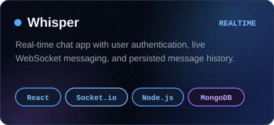
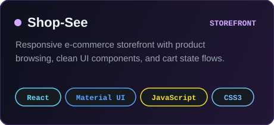
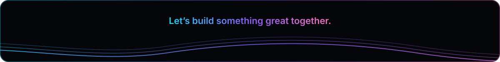

<!-- 1. INTRO SECTION -->

  

 

<!-- ACTION BUTTONS (NO TABLE LINES, NO UNDERLINE DASHES) -->

  
  
  

 

<!-- 2. FEATURED PROJECTS SECTION (2x2 GRID WITHOUT TABLE LINES) -->

  <h2>Featured Projects</h2>

  

    

      
      
    

    

      
      
    

  

 

<!-- 3. TECH STACK SECTION -->

  <h2>Tech Stack</h2>

  

    
  

 

<!-- 4. FOOTER SECTION -->

  

