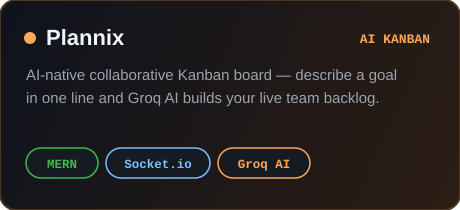
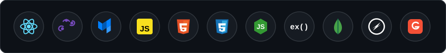

<!-- 1. INTRO SECTION -->

  

     

  
  &nbsp;&nbsp;
  
  &nbsp;&nbsp;
  

 

<!-- 2. FEATURED PROJECTS SECTION -->

  <h2 align="left">Featured Projects</h2>

  <table width="100%" cellspacing="12" cellpadding="0">
    <tr>
      <td width="50%" valign="top">
        
      </td>
      <td width="50%" valign="top">
        
      </td>
    </tr>
    <tr>
      <td width="50%" valign="top">
        
      </td>
      <td width="50%" valign="top">
        
      </td>
    </tr>
  </table>

 

<!-- 3. TECH STACK SECTION -->

  <h2 align="left">Tech Stack</h2>

  

 

<!-- 4. FOOTER SECTION -->

  

